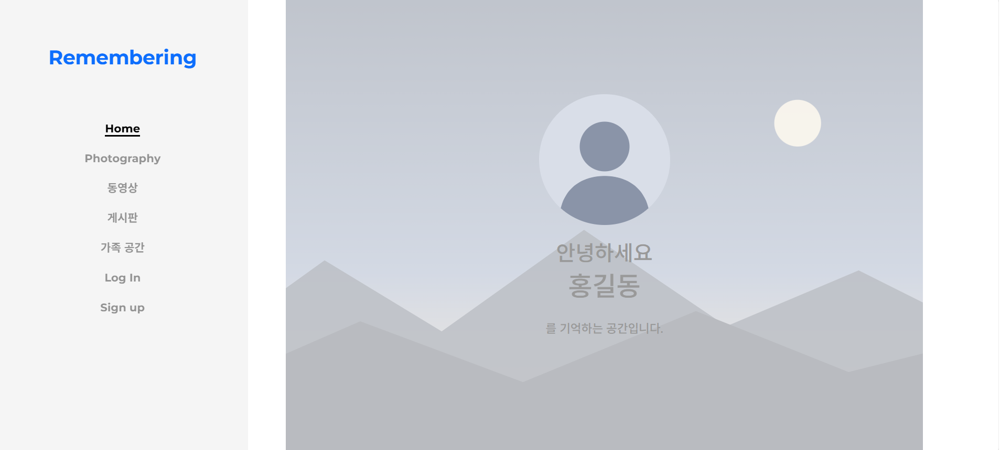
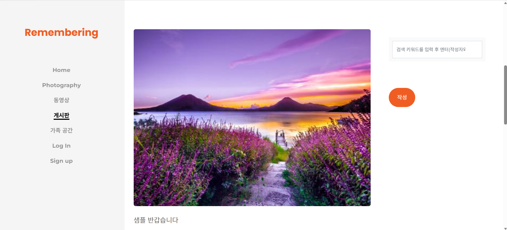
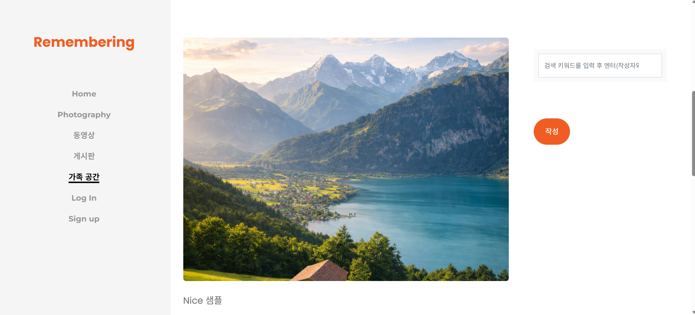

# Remembering

세상을 떠난 가족을 기억하기 위한 추모 공간 웹 애플리케이션입니다.
사진과 동영상 앨범, 누구나 글을 남길 수 있는 추모 게시판, 가족만 글을 쓸 수 있는 가족 공간으로 이루어져 있습니다.

처음에는 Django로 만들었던 것을 Spring Boot로 다시 구현했고, 이후 보안과 구조를 중심으로 전체를 리팩터링했습니다.

| 홈 | 추모 게시판 | 가족 공간 |
|---|---|---|
|  |  |  |

## 주요 기능

- **추모 게시판**: 로그인 없이 누구나 글, 사진, 동영상을 남길 수 있습니다. 글마다 정한 비밀번호로 수정하고 삭제합니다.
- **가족 공간**: 누구나 읽을 수 있고, 가족으로 지정된 회원만 글을 쓸 수 있습니다.
- **앨범**: 사진과 동영상을 모아 보여 줍니다. 사진 정보는 엑셀 파일로 한 번에 등록합니다.
- **검색과 페이지 나눔**, 이미지 썸네일 자동 생성

### 역할과 권한

| 기능 | 비회원 | 일반 회원 | 가족 | 관리자 |
|---|:-:|:-:|:-:|:-:|
| 추모 게시판 읽기, 쓰기 | O | O | O | O |
| 추모 게시판 수정, 삭제 | 글 비밀번호 | 글 비밀번호 | 글 비밀번호 | 글 비밀번호 |
| 가족 공간 읽기 | O | O | O | O |
| 가족 공간 쓰기 | | | O | O |
| 가족 공간 수정, 삭제 | | | 본인 글 | 모든 글 |
| 앨범 자료 등록 | | | | O |

## 기술 스택

- Java 17, Spring Boot 3.2 (Web, Data JPA, Security, Validation)
- Thymeleaf, Bootstrap
- MySQL 8
- Gradle, Docker Compose
- Thumbnailator(썸네일), Apache POI(엑셀), Log4j2

## 실행 방법

Docker만 설치되어 있으면 됩니다.

```bash
git clone https://github.com/JYGim/remembering-spring.git
cd remembering-spring
cp .env.example .env      # 파일을 열어 DB 계정과 비밀번호를 채웁니다
docker compose up -d --build
```

브라우저에서 http://localhost:8080 을 엽니다. 처음 실행할 때 테이블이 자동으로 만들어집니다.

### 가족, 관리자 지정

회원가입을 하면 일반 회원이 됩니다. 가족과 관리자는 운영자가 DB에서 직접 지정합니다.

```bash
docker compose exec db sh -c 'mysql -u"$MYSQL_USER" -p"$MYSQL_PASSWORD" "$MYSQL_DATABASE" \
  -e "UPDATE users SET role=\"ADMIN\" WHERE email=\"admin@example.com\";"'
```

`role`에는 `USER`, `FAMILY`, `ADMIN` 중 하나를 넣습니다. 바꾼 뒤 다시 로그인하면 적용됩니다.

## 설정

| 환경 변수 | 설명 | 기본값 |
|---|---|---|
| `DB_NAME`, `DB_USERNAME`, `DB_PASSWORD` | 데이터베이스 접속 정보 | 없음(필수) |
| `MYSQL_ROOT_PASSWORD` | MySQL 관리자 비밀번호 | 없음(필수) |
| `UPLOAD_DIR` | 업로드 파일을 저장할 폴더 | `media` |
| `MEMORIAL_NAME` | 사이트에 표시할 이름 | `홍길동` |
| `HERO_IMAGE` | 배경 사진 주소 | 기본 그림 |
| `PROFILE_IMAGE` | 홈 화면의 프로필 사진 주소 | 기본 그림 |

사용자가 올린 파일과 앨범 사진은 프로그램과 분리된 업로드 폴더에 저장됩니다. Docker로 실행하면 `media_data` 볼륨에 보관되어 컨테이너를 다시 만들어도 남습니다.

## 로컬 개발

DB만 Docker로 띄우고 애플리케이션은 직접 실행합니다.

```bash
docker compose up -d db
./gradlew bootRun
```

사이트 이름과 대표 사진은 프로젝트 폴더에 `config/application.yml`을 만들어 바꿀 수 있습니다. 이 파일은 git에 올라가지 않습니다.

```yaml
app:
  site:
    memorial-name: 표시할 이름
    hero-image: /album/photo/1.jpg
    profile-image: /album/photo/2.jpg
```

## 앨범 사진 등록

1. 사진 파일을 업로드 폴더의 `album/photo/`에 넣습니다. Docker로 실행 중이라면 아래처럼 복사합니다.

   ```bash
   docker compose cp ./photos/. web:/app/media/album/photo/
   ```

2. 관리자로 로그인해 `/util/album/upload-form`에서 엑셀 파일(.xlsx)을 올립니다.

엑셀 파일은 `photo` 시트의 3번째 줄부터 아래 순서로 적습니다.

| 열 | 내용 | 예 |
|---|---|---|
| A | 제목 | 1 |
| B | 촬영 연도 | 1970 |
| C | 촬영 월일 | 0723 |
| D | 촬영일을 정확히 아는지 | Y 또는 N |
| E | 추정 연도(D가 N일 때) | 1970 |
| F | 정보 | |
| G | 설명 | |
| H | 사진 경로 | album/photo/1.jpg |
| I | 표시 순서 | 1 |

## 프로젝트 구조

```
src/main/java/kr/co/felici/remembering
├── config       보안, 정적 자원, 업로드 경로, 사이트 설정
├── controller   화면 요청 처리
├── service      업무 로직
├── repository   데이터 접근 (Spring Data JPA)
├── domain       엔티티와 검색 조건
├── dto          화면과 주고받는 데이터
├── exception    예외
└── util         이미지 처리
```

## 리팩터링하며 고친 것

2년 전에 만든 코드를 다시 읽으며 문제를 찾아 고쳤습니다.

**보안**
- 코드에 적혀 있던 DB 비밀번호와 API 키를 환경 변수로 분리
- 비밀번호 확인 없이 주소만으로 실행되던 삭제(GET)를 없애고 POST로 통일
- 가족 공간에 작성자 확인이 없어 남의 글을 지울 수 있던 문제 수정, 역할(USER, FAMILY, ADMIN) 도입
- CSRF 보호 활성화, 로그아웃을 POST로 변경
- 오류 화면에 스택 트레이스가 노출되던 문제 수정
- 로그에 비밀번호가 남던 코드 제거

**버그**
- 목록에서 삭제 창의 id가 겹쳐 다른 글이 삭제되던 문제
- 파일을 저장할 때 파일 경로를 폴더로 만들던 문제
- 싱글톤 서비스의 필드에 요청별 상태를 담아, 동시 요청에서 결과가 섞일 수 있던 문제
- 없는 글 번호로 접근하면 500 오류가 나던 문제(404로 변경)

**구조와 성능**
- 업로드 경로와 사이트 정보를 설정으로 분리
- 글쓰기와 수정에 따로 있던 파일 저장 로직 통합
- 목록 조회의 N+1 문제를 batch fetch로 완화
- Spring Security 설정을 람다 방식으로 전환
- Docker 다단계 빌드, 전용 사용자로 실행
- 사용하지 않는 코드, 의존성, 설정 정리

## 화면 디자인

- 화면은 [Colorlib](https://colorlib.com)의 무료 템플릿(CC BY 3.0)을 바탕으로 수정했습니다.
- 견본 화면의 사진은 [Unsplash](https://unsplash.com)에서 가져왔습니다.

## 앞으로 할 일

- 테스트 코드 작성(권한 규칙, 파일 처리)
- GitHub Actions로 빌드와 테스트 자동화
- Flyway로 테이블 변경 이력 관리
- 동영상 앨범 등록 기능
- 모바일 앱을 위한 REST API
- 화면 디자인 개편
- 관리자가 추모 게시판의 글을 관리(삭제)하는 기능
